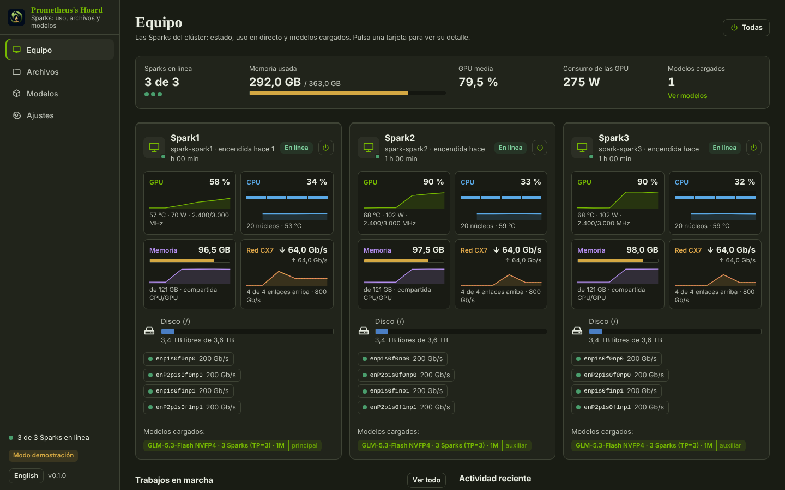
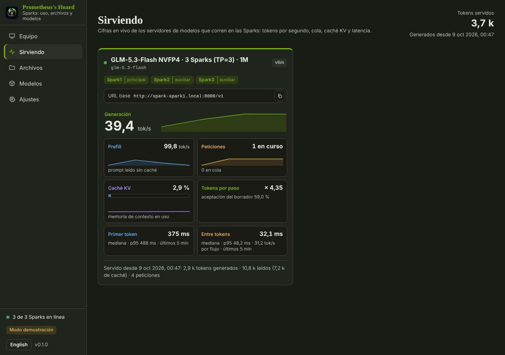
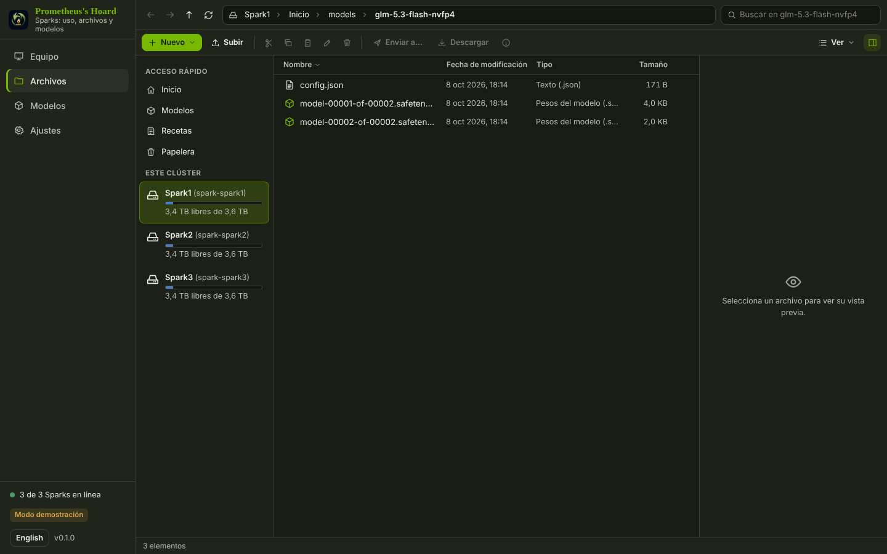
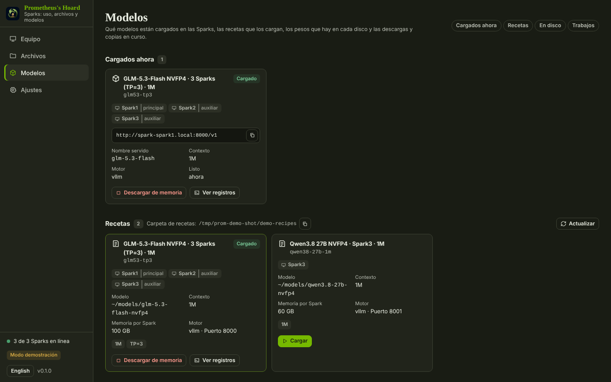

# Prometheus's Hoard

Gestiona un pequeño clúster de ordenadores NVIDIA DGX Spark desde un PC con Windows: estado en vivo, archivos, modelos, recetas y energía de cada Spark en una sola ventana.



## Qué es

Cada Spark aparece como una unidad en un explorador de archivos. Su GPU, CPU, memoria unificada, energía, discos y red están en un panel en vivo, los modelos de sus discos se listan y descargan, los modelos se cargan y descargan mediante recetas, y cada Spark puede bloquearse, suspenderse, apagarse, reiniciarse o despertarse desde la misma ventana.

Es una app de la familia Hoard: funciona sola, desde el Hoard Hub, desde Faustus y desde cualquier cliente MCP. Faustus la lee para usar las Spark como su backend de modelos por defecto.

## Qué hace

**Estado del clúster**
- **Equipo**: una tarjeta por Spark con estado, tiempo encendida, uso de GPU, temperatura, consumo y reloj, uso de CPU por núcleo, memoria unificada, disco, enlaces CX7 y los modelos que sirve (cabeza o trabajador). Una vista tipo Administrador de tareas por Spark con gráficas grandes, procesos, contenedores, servidores de inferencia detectados e interfaces de red.
- **Red CX7 - Pares de Sparks**: lee de las métricas en caché el estado del enlace, la velocidad, la MTU y las direcciones de destino detectadas de cada par. Es una lectura manual, no una prueba de conectividad ni de rendimiento.
- **Historial**: muestras por minuto conservadas 90 días por defecto (uso de GPU, CPU, memoria unificada, temperatura, consumo), mostradas de 1 h a 30 días para todas las Spark o una, con cursor de lectura, huecos y caídas marcados, y un resumen por Spark con la energía en kWh y, si se fija un precio, el coste.
- **Avisos**: una Spark cuya sonda sigue fallando, o un servidor de modelos cuya comprobación de salud sigue fallando, abre una incidencia: un banner en todas las páginas, la lista de caídas con inicio y duración, un evento en el bus de la familia y una notificación por el hub. Apagar una Spark desde la app se registra como esperado.
- **Errores de GPU**: cada minuto se leen los mensajes nuevos del kernel de cada Spark y se conservan los que informan de un Xid de NVIDIA, un reinicio completo del chip o un fallo de GSP, se marcan en la tarjeta de la Spark y se anuncian. Solo avisa; nunca reinicia ni restablece nada.

**Servicio de modelos**
- **Sirviendo**: cifras en vivo de cada servidor de inferencia en marcha, leídas de la página de métricas que publica cada servidor vLLM: tokens por segundo de generación y de lectura del prompt con gráfica de diez minutos, peticiones en curso y en espera, uso de la caché KV, tokens por paso y aceptación de la decodificación especulativa, mediana y percentil 95 del tiempo hasta el primer token y entre tokens, avisos de expulsiones, tokens servidos hasta ahora y la URL base lista para copiar.
- **Clientes** de cada servidor, obtenidos del registro de accesos del contenedor y, en este PC, de la tabla de conexiones del sistema operativo, con nombres que puedes editar.
- **Velocidad**: una medición que inicias de forma explícita (pide confirmación antes) y que se ejecuta con 1, 8, 16 y 64 flujos concurrentes con prompts únicos e informa de tokens por segundo agregados y por flujo, p50 y p95 del primer token y peticiones fallidas. Se conservan los últimos 20 resultados por servidor y **Comparar mediciones** compara dos tarjetas guardadas nivel a nivel.
- **Capacidad**: el contexto que acepta el servidor, el pool KV en tokens y lo que la receta registró como verificado.

**Archivos y modelos**
- **Archivos**: un explorador con cada Spark como unidad: barra de direcciones, historial, búsqueda, vistas de detalles e iconos, archivos ocultos, vista previa de texto, JSON, imágenes, vídeo y audio, edición en el sitio de archivos de texto, subida arrastrando, descarga, carpeta y archivo nuevos, renombrar, cortar/copiar/pegar, envío a otras Spark por los cables CX7, propiedades y una papelera por Spark con restauración. Las escrituras quedan dentro de la carpeta personal del usuario de la Spark.
- **Modelos**: lo que está cargado ahora con su URL compatible con OpenAI; recetas con Cargar, Descargar y Reiniciar; modelos de cada disco con tamaño, arquitectura, cuantización y contexto; descargas desde Hugging Face (opcionalmente solo los archivos que coincidan con patrones); copias entre Spark por CX7 (rsync, reanudables, con carpeta de destino opcional); trabajos con progreso, registros y vista de detalle.
- **Recetas**: una carpeta con `recipe.json` y los scripts que arrancan y paran un servidor (`start.sh`, `stop.sh`, y opcionalmente `health.sh` y `logs.sh`). Cargar copia la carpeta a cada Spark que usa, la arranca como trabajo desacoplado y espera a que la cabeza responda en su puerto; los conflictos con otra receta cargada se indican y se puede descargar la otra antes. Las recetas medidas muestran tokens de entrada, velocidad de generación, tiempo hasta el primer token y resultados de recuperación a partir de sus datos registrados.
- **Recuperación**: una receta gestionada que degenera (dos fallos estructurales completos de la prueba canaria) puede recargarse con el ciclo de vida existente, bajo el cerrojo del modelo principal; véase [`docs/recovery.md`](docs/recovery.md).

**Energía y escritorio**
- Bloquear, suspender, apagar y reiniciar una Spark o todas; para encender se usa wake-on-LAN con la MAC cableada aprendida mientras la Spark estaba encendida. Los modelos se descargan antes de apagar.
- **Escritorio**: desde la página de una Spark, muestra y maneja su propio escritorio gráfico en el navegador. Bajo demanda, la Spark ejecuta un servidor VNC con una sesión XFCE en una pantalla virtual, que se usa con un cliente noVNC integrado: pantalla completa, resolución que sigue a la ventana, portapapeles en ambos sentidos, y funciona con el ancho de un móvil. La instalación es un trabajo confirmado.

**Puntos de acceso para otros programas**
- `GET /api/endpoints` lista los servidores de inferencia en marcha, con la receta por defecto primero. `GET /api/serving` devuelve las cifras en vivo de esos servidores.

## Cómo se ejecuta

```
python -m venv venv
venv\Scripts\pip install -r requirements.txt
venv\Scripts\python -m prometheus_hoard        # http://127.0.0.1:5205
```

Se llega a las Spark con la configuración SSH del PC (`~/.ssh/config` y sus `Include`). En Ajustes cada Spark puede tener otra dirección o un salto. `PROMETHEUS_FAKE=1` arranca un clúster inventado de tres Spark en una carpeta temporal, para probar la interfaz sin hardware. La carpeta de recetas es un ajuste.

## Conexión con Faustus y la familia Hoard

- **MCP**: `python mcp_server.py` es el puente por stdio (unas cincuenta herramientas); `faustus-plugin.json` lo describe para Faustus y el Hoard Hub. Las herramientas destructivas (borrados permanentes, vaciar la papelera, borrar un modelo, acciones de energía, comandos de shell) exigen `confirm=true`.
- **Grupos de herramientas**:

| Área | Herramientas |
| --- | --- |
| Estado | `sparks_overview`, `spark_status`, `spark_history`, `metrics_history`, `alerts`, `xid_events`, `fabric_status`, `endpoints` |
| Servicio | `serving_stats`, `client_name_set`, `speed_card`, `speed_card_run` |
| Despliegues | `deploy_start`, `deploy_stop`, `deploy_restart`, `deployments`, `deploy_logs`, `deploy_report_issue`, `deploy_recovery_status`, `recipes_list`, `recipe_write` |
| Modelos y trabajos | `models_list`, `model_download`, `model_copy`, `model_delete`, `jobs_list`, `job_get`, `job_cancel`, `hf_token_set` |
| Archivos | `files_list`, `files_search`, `file_info`, `file_read`, `file_write`, `file_rename`, `files_copy`, `files_move`, `files_transfer`, `files_delete`, `folder_create`, `trash_list`, `trash_restore`, `trash_empty` |
| Energía y escritorio | `power`, `spark_exec`, `desktop_status`, `desktop_start`, `desktop_stop`, `desktop_install`, `desktop_clipboard_get`, `desktop_clipboard_set` |
| Ajustes | `settings_get`, `settings_set` |

- **Copiloto**: un botón flotante de Faustus abre el asistente en un panel lateral. Se le informa de la Spark, los despliegues y los ajustes abiertos y de los campos sin guardar (nunca se envían el token del hub de modelos ni el contenido de los archivos); la vista se recarga en el sitio tras cada turno y los ajustes envían solo los campos que cambiaste (`nodes_patch`, `nodes_remove`).
- **Hub**: eventos `prometheus.alert.spark_down`, `spark_up`, `server_down` y `server_up`, notificaciones, y un arrendamiento sobre el modelo principal para que solo una app lo recargue a la vez.
- **Skills**: `cluster-model-serving`, `deployment-patterns`, `docker-patterns` y `performance-optimization` se ofrecen a los agentes que se conectan.

## Límites

- Las cifras de servicio solo proceden de la página de métricas de vLLM; un servidor de otro motor aparece con el motivo por el que no tiene cifras. Se guardan unos 15 minutos de muestras en memoria, así que las gráficas empiezan vacías tras reiniciar.
- Una dirección de cliente es un dispositivo: los programas de otros ordenadores no se distinguen y un proxy oculta a sus clientes. Los totales de tokens solo cuentan lo que la app vio mientras se ejecutaba.
- La medición de velocidad compite con cualquier otro uso del modelo, y un servidor que rechaza `ignore_eos` puede terminar algunos flujos antes.
- El escritorio remoto es una sesión VNC propia, no la consola de la Spark: sin aceleración 3D ni audio, y lo que haya abierto se cierra al pararlo. Instalarlo requiere `sudo` sin contraseña para `apt-get`.
- Apagar, reiniciar y suspender requieren `sudo` sin contraseña (o una regla polkit) en las Spark; wake-on-LAN requiere tenerlo activado en el firmware.
- No instala controladores, no cambia la red de las Spark ni compila motores de inferencia; eso lo hacen las recetas. No se pueden descargar carpetas enteras al PC de una vez.

## Estructura del proyecto

| Ruta | Contenido |
| --- | --- |
| `prometheus_hoard/` | Servidor Python: clúster, archivos, modelos, recetas, servicio, tarjeta de velocidad, historial, avisos, escritorio, energía, herramientas del agente |
| `prometheus_hoard/static/` | Interfaz compilada (código en `client/`) |
| `mcp_server.py` | Puente MCP por stdio |
| `docs/` | Arquitectura, recuperación, capturas |
| `tests/` | Suite de pytest |

```
python -m pytest           # backend, contra el clúster inventado
npx vite build             # interfaz en prometheus_hoard/static
```

Véase [`docs/ARCHITECTURE.md`](docs/ARCHITECTURE.md).

<details>
<summary>Pantallas</summary>




</details>

Licencia MIT.
