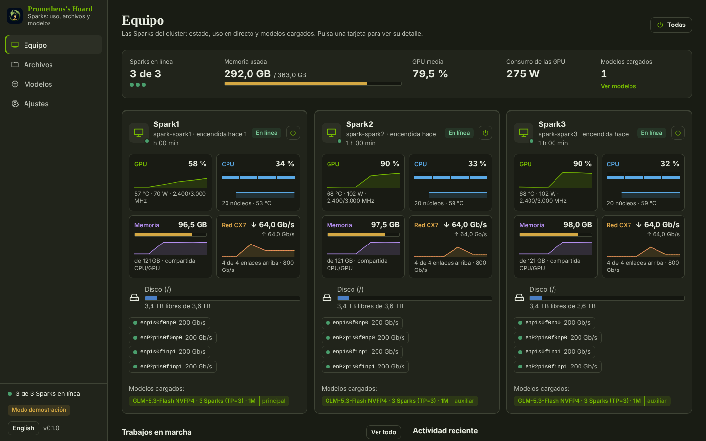
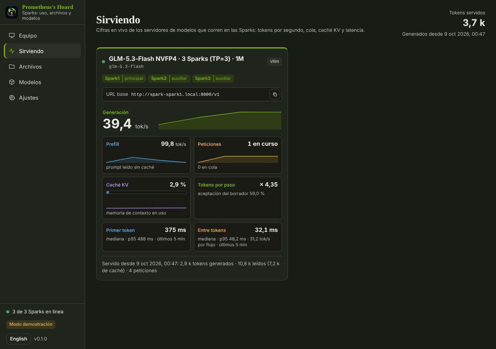
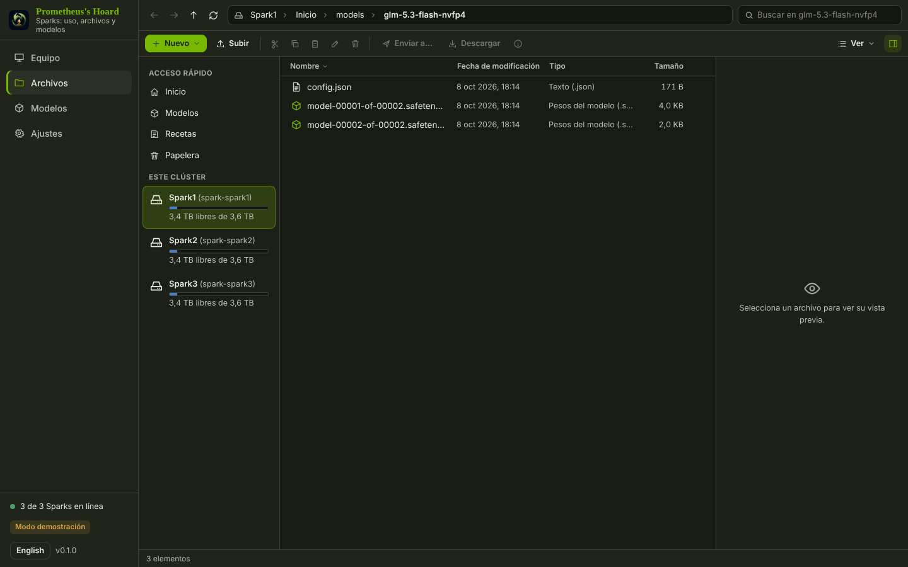
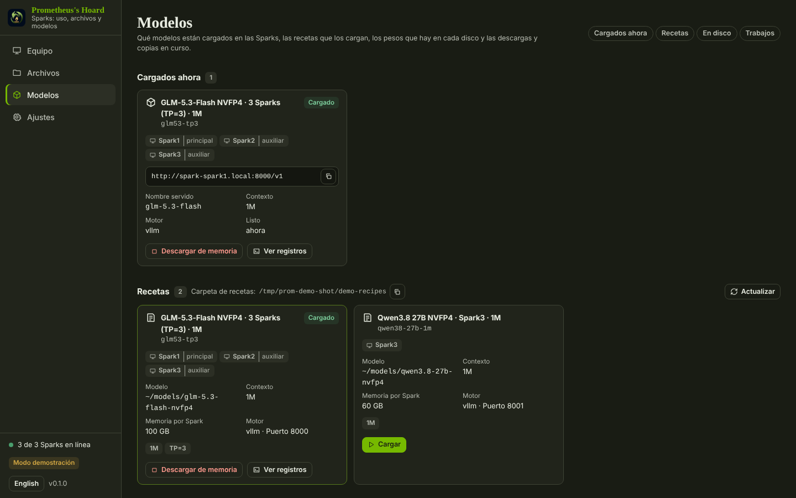

# Prometheus's Hoard

Runs a small cluster of NVIDIA DGX Spark computers from a Windows PC: live status, files, models, recipes and power for every Spark in one window.



## What it is

Each Spark appears as a drive in a file explorer. Its GPU, CPU, unified memory, power, disks and network are on a live panel, the models on its disks are listed and downloaded, models are loaded and unloaded through recipes, and every Spark can be locked, put to sleep, shut down, restarted or woken from the same window.

It is one app of the Hoard family: it works on its own, from the Hoard Hub, from Faustus and from any MCP client. Faustus reads it to use the Sparks as its default model backend.

## What it does

**Cluster status**
- **Equipo**: one card per Spark with state, uptime, GPU use, temperature, power and clock, CPU use per core, unified memory, disk, CX7 links and the models it serves (head or worker). A Task Manager-style view per Spark with large charts, processes, containers, detected inference servers and network interfaces.
- **Red CX7 - Pares de Sparks**: reads each pair's detected link state, speed, MTU and destination addresses from cached metrics. A manual read, not a connectivity or throughput test.
- **Historial**: per-minute samples kept for 90 days by default (GPU use, CPU, unified memory, temperature, power), shown over 1 h to 30 days for all Sparks or one, with a crosshair, gaps and outages marked, and a summary per Spark including energy in kWh and, with a price set, the cost.
- **Avisos**: a Spark whose probe keeps failing, or a model server whose health check keeps failing, opens an incident: a banner on every page, the list of outages with start and duration, an event on the family bus and a notification through the hub. Powering a Spark off from the app is recorded as expected.
- **GPU errors**: new kernel messages of each Spark are read every minute and the ones reporting an NVIDIA Xid, a full-chip reset or a GSP failure are kept, flagged on the Spark card and announced. It only warns; it never restarts or resets anything.

**Serving**
- **Sirviendo**: live figures of every running inference server read from the metrics page each vLLM server publishes: generation and prompt-reading tokens per second with a ten-minute chart, requests running and waiting, KV cache use, tokens per step and acceptance of speculative decoding, median and 95th percentile of time to first token and between tokens, preemption warnings, tokens served so far and the base URL ready to copy.
- **Clients** of each server, taken from the container's access log and, on this PC, from the operating system's connection table, with names you can edit.
- **Velocidad**: a measurement you start explicitly (it asks first) that runs at 1, 8, 16 and 64 concurrent streams with unique prompts and reports aggregate and per-stream tokens per second, first-token p50 and p95 and failed requests. The last 20 results per server are kept, and **Comparar mediciones** compares two saved cards level by level.
- **Capacidad**: the context the server accepts, the KV pool in tokens and what the recipe recorded as verified.

**Files and models**
- **Archivos**: an explorer with every Spark as a drive: address bar, history, search, details and icon views, hidden files, preview of text, JSON, images, video and audio, in-place editing of text files, upload by drag and drop, download, new folder and file, rename, cut/copy/paste, sending to other Sparks over the CX7 cables, properties and a trash per Spark with restore. Writes stay inside the Spark user's home folder.
- **Modelos**: what is loaded now with its OpenAI-compatible URL; recipes with Load, Unload and Restart; models on each disk with size, architecture, quantisation and context; downloads from Hugging Face (optionally only files matching patterns); copies between Sparks over CX7 (rsync, resumable, with an optional destination folder); jobs with progress, logs and detail view.
- **Recipes**: a folder with `recipe.json` and the scripts that start and stop a server (`start.sh`, `stop.sh`, optional `health.sh` and `logs.sh`). Loading copies the folder to each Spark it uses, starts it as a detached job and waits until the head answers on its port; conflicts with another loaded recipe are reported and the other can be unloaded first. Measured recipes show input tokens, generation speed, time to first token and retrieval results from their recorded data.
- **Recovery**: a managed recipe that degenerates (two complete structural canary failures) can be reloaded through the existing lifecycle, under the principal-model lock; see [`docs/recovery.md`](docs/recovery.md).

**Power and desktop**
- Lock, sleep, shut down and restart one Spark or all of them; waking uses wake-on-LAN with the wired MAC address learnt while the Spark was on. Models are unloaded before a shutdown.
- **Escritorio**: from a Spark's page, shows and drives its own graphical desktop in the browser. On demand the Spark runs a VNC server with an XFCE session on a virtual screen, used with a built-in noVNC client: fullscreen, resolution that follows the window, two-way clipboard, and it works at phone width. Installation is a confirmed job.

**Endpoints for other programs**
- `GET /api/endpoints` lists the inference servers running now, the default recipe first. `GET /api/serving` returns the live figures of those servers.

## Run it

```
python -m venv venv
venv\Scripts\pip install -r requirements.txt
venv\Scripts\python -m prometheus_hoard        # http://127.0.0.1:5205
```

The Sparks are reached with the SSH configuration of the PC (`~/.ssh/config` and its `Include`s). In Ajustes each Spark can have a different address or a jump host. `PROMETHEUS_FAKE=1` starts an invented three-Spark cluster in a temporary folder, for trying the interface without hardware. The recipes folder is a setting.

## Connect to Faustus and the Hoard family

- **MCP**: `python mcp_server.py` is the stdio bridge (about fifty tools); `faustus-plugin.json` describes it for Faustus and the Hoard Hub. Destructive tools (permanent deletes, emptying the trash, deleting a model, power actions, shell commands) need `confirm=true`.
- **Tool groups**:

| Area | Tools |
| --- | --- |
| Status | `sparks_overview`, `spark_status`, `spark_history`, `metrics_history`, `alerts`, `xid_events`, `fabric_status`, `endpoints` |
| Serving | `serving_stats`, `client_name_set`, `speed_card`, `speed_card_run` |
| Deployments | `deploy_start`, `deploy_stop`, `deploy_restart`, `deployments`, `deploy_logs`, `deploy_report_issue`, `deploy_recovery_status`, `recipes_list`, `recipe_write` |
| Models and jobs | `models_list`, `model_download`, `model_copy`, `model_delete`, `jobs_list`, `job_get`, `job_cancel`, `hf_token_set` |
| Files | `files_list`, `files_search`, `file_info`, `file_read`, `file_write`, `file_rename`, `files_copy`, `files_move`, `files_transfer`, `files_delete`, `folder_create`, `trash_list`, `trash_restore`, `trash_empty` |
| Power and desktop | `power`, `spark_exec`, `desktop_status`, `desktop_start`, `desktop_stop`, `desktop_install`, `desktop_clipboard_get`, `desktop_clipboard_set` |
| Settings | `settings_get`, `settings_set` |

- **Copilot**: a floating Faustus button opens the assistant in a side panel. It is told which Spark, deployments and settings are open and any unsaved fields (the model-hub token and file contents are never sent); the view reloads in place after each turn and settings send only the fields you changed (`nodes_patch`, `nodes_remove`).
- **Hub**: events `prometheus.alert.spark_down`, `spark_up`, `server_down` and `server_up`, notifications, and a lease on the principal model so only one app reloads it at a time.
- **Skills**: `cluster-model-serving`, `deployment-patterns`, `docker-patterns` and `performance-optimization` are offered to connecting agents.

## Limits

- Serving figures come only from vLLM's metrics page; a server of another engine is listed with the reason it has no figures. About 15 minutes of samples are kept in memory, so charts start empty after a restart.
- One client address is one device: programs on other computers are not told apart and a proxy hides its clients. Token totals only count what the app saw while it ran.
- The speed measurement competes with whatever else uses the model, and a server that rejects `ignore_eos` may end some streams early.
- The remote desktop is a VNC session of its own, not the Spark's console: no 3D acceleration or audio, and what is open in it closes when it stops. Installing it needs passwordless `sudo` for `apt-get`.
- Shutdown, restart and sleep need passwordless `sudo` (or a polkit rule) on the Sparks; wake-on-LAN needs it enabled in the firmware.
- It does not install drivers, change the Sparks' network or build inference engines; recipes do that. Whole folders cannot be downloaded to the PC in one go.

## Project layout

| Path | Contents |
| --- | --- |
| `prometheus_hoard/` | Python server: cluster, files, models, recipes, serving, speed card, history, alerts, desktop, power, agent tools |
| `prometheus_hoard/static/` | Built interface (source in `client/`) |
| `mcp_server.py` | Stdio MCP bridge |
| `docs/` | Architecture, recovery, screenshots |
| `tests/` | pytest suite |

```
python -m pytest           # backend, against the invented cluster
npx vite build             # interface into prometheus_hoard/static
```

See [`docs/ARCHITECTURE.md`](docs/ARCHITECTURE.md).

<details>
<summary>Screens</summary>




</details>

MIT licence.
